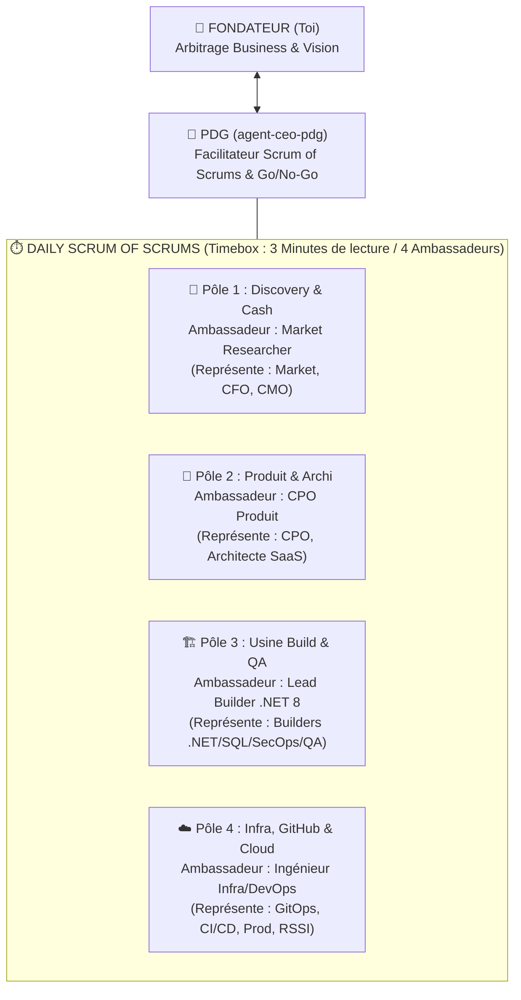

# ⏱️ Gouvernance de l'Entreprise Agentique — Approche « Scrum of Scrums » & Journée Type

Ce document codifie le fonctionnement quotidien minimaliste et léger de notre **Venture Studio Agentique**.
Objectif : **Zéro réunionite, zéro surcharge ( pas d'exécution lourde de tests ou d'audits à chaque échange )**, prise de décision rapide entre le **Fondateur** et le **PDG**, entourés uniquement des **4 Chefs de Pôle (Ambassadeurs)**.

---

## 1. Structure du « Scrum of Scrums » (Limité à 6 Participants max)

En Scrum à l'échelle (*Scrum of Scrums*), le Fondateur ne parle **jamais** aux 15 agents exécutants en même temps.Chaque équipe interne fait son point en tâche de fond et délègue **1 seul Ambassadeur** au Daily Exécutif :

### Le Format Strict du Daily Exécutif (Timeboxé — 3 Lignes max par Pôle)
Lors de chaque **Daily Scrum of Scrums**, chaque Ambassadeur de Pôle a interdiction de dépasser **3 puces ultra-courtes** :
1. **✅ Fait / Livrable concret** (1 ligne)
2. **🎯 Priorité immédiate du jour** (1 ligne)
3. **🚨 Blocage ou Décision attendue du Fondateur** (1 ligne — ou *"RAS"*)

---

## 2. 📅 La Journée Type Cadencée de l'Entreprise Agentique

| Créneau | Pôle Actif | Activité (Légère, Minimaliste & Orientée Marché) | Livrable Attendu |
| :--- | :--- | :--- | :--- |
| **09h00 – 09h05** | **Scrum of Scrums** *(Fondateur + PDG + 4 Ambassadeurs)* | **Daily Meeting Exécutif** : Lecture du tableau de bord en 4 blocs (Traction Produit #1, Radar Vague 2, État Build, État Infra/GitHub) et décision du Fondateur en 1 phrase. | Ordre du jour validé |
| **Matin (Bloc 1)** | **Pôle 1 : Discovery & Finance** *(`Market` + `CFO` + `CMO`)* | **Chasse & Analyse Financière** : Analyse des retours du Smoke-Test en ligne (clics 250€/mois) + Chiffrage LTV/CAC d'une nouvelle pépite en veille continue. | 1 Fiche Opportunité ou Ajustement GTM |
| **Matin (Bloc 2)** | **Pôle 2 : Produit & SaaS** *(`CPO` + `Architecte SaaS`)* | **Cadrage Minimaliste (YAGNI)** : Traduction des retours utilisateurs en 1 amélioration à fort impact (ex: nouvelle grille assureur ou écran de démo). | Spec courte < 20 lignes |
| **Après-midi (Bloc 3)** | **Pôle 3 : Build .NET** *(`Builders .NET 8 / SQL / SecOps`)* | **Construction Rapide par Couche** : Écriture du code C# / Web strictement nécessaire (*1 Type = 1 Fichier*), sans lancer de suites de tests lourdes pendant l'idéation. | Code propre prêt à pousser |
| **Fin de journée (Bloc 4)** | **Pôle 4 : Infra, GitOps & Qualité** *(`agent-infra-devops` + Audit léger)* | **Push GitHub & Déploiement Continu** : `git push` vers le compte GitHub du Fondateur $\rightarrow$ GitHub Actions déploie la WebDemo sur GitHub Pages / Cloud et vérifie la compilation en tâche de fond. | URL en ligne à jour |

---

## 3. Comment lancer ton Daily Meeting en 1 seconde dans le Chat ?

Il te suffit d'écrire :
> **« Lance le Daily Scrum of Scrums »**

Et le **PDG (`agent-ceo-pdg`)** te présente instantanément le rapport consolidé des **4 Ambassadeurs** en moins de 15 lignes, terminé par la **seule question** qui nécessite ton arbitrage de Fondateur !
